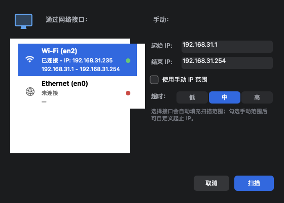
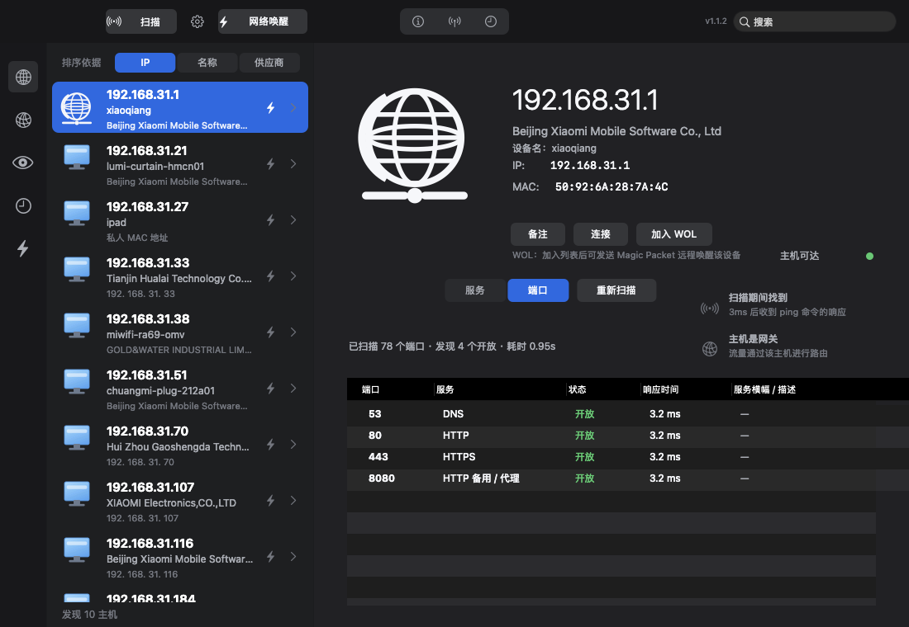
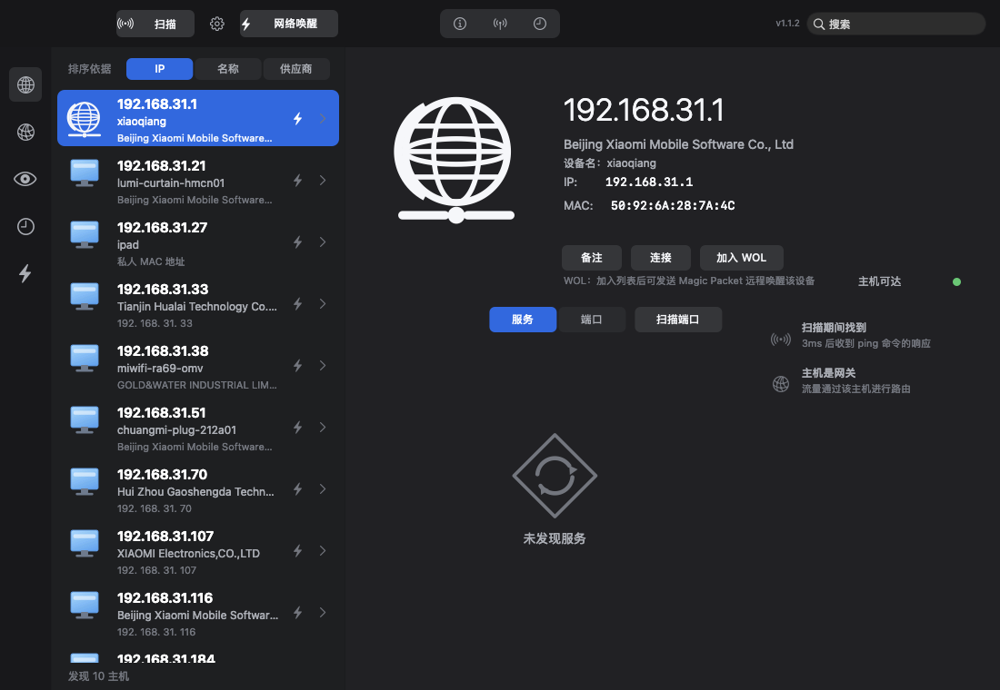
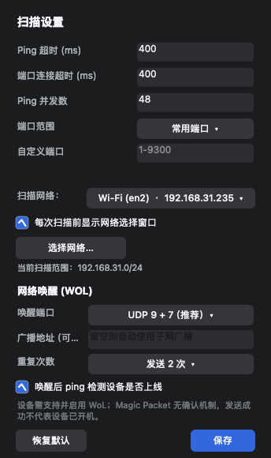
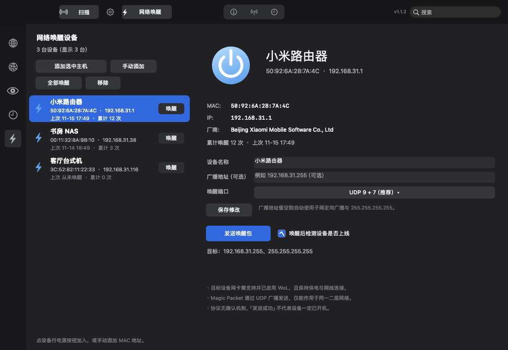

# LANScanner

A native macOS LAN scanning and management tool.

## Features

- **LAN Device Scanning**: Automatically discover active devices in the LAN, supports ARP cache reading and active ping scanning
- **Device Information Display**: Displays IP address, MAC address, vendor information, hostname, etc.
- **Port Scanning**: Perform common port scans on selected devices, supports custom port lists
- **Wake on LAN **(WOL) Supports remote device wake-up, allows batch wake-up
- **Network Selection**: Supports switching between multiple network interfaces, allows manual specification of scan IP range
- **macOS Native**: Developed using AppKit, clean and beautiful interface

## System Requirements

- macOS 11.0 (Big Sur) or higher
- Requires admin privileges to read ARP table and perform network operations

## Installation

### Method 1: Download Pre-built Version

Download the latest `.dmg` installer package from [Gitee Releases](https://gitee.com/xiaoyf/lanscanner/releases), double-click to open, then drag the application into the "Applications" folder.

### Method 2: Build from Source

```bash
# Clone repository
git clone https://gitee.com/xiaoyf/lanscanner.git
cd lanscanner

# Build project
./build.sh

# After compilation, the application will be located in the build/ directory
```

## Usage

1. **Launch Application**: Open LANScanner in the "Applications" folder
2. **Select Network**: The network selector will pop up on first use; select the network interface and IP range you wish to scan
3. **Start Scanning**: Click the "Scan" button on the toolbar to start scanning LAN devices
4. **View Details**: Click on a device in the list to view detailed information, including port scan results
5. **WOL Wake-up**: Select devices and click the "WOL" button to add them to the wake-up list, supports remote wake-up

### Shortcuts

- `Cmd + R`: Rescan
- `Cmd + ,`: Open Settings
- `Cmd + F`: Search Devices

## Configuration Options

The following options can be configured in "Settings":

- **Ping Timeout**: Single ping timeout time (milliseconds)
- **Port Timeout**: Port scan timeout time
- **Concurrency**: Number of devices scanned simultaneously
- **Port Presets**: Choose common port combinations or customize ports
- **WOL Settings**: Broadcast address, port mode, repeat count, etc.

## Technical Implementation

- **UI Framework**: AppKit (NSViewController, NSTableView)
- **Network Detection**: Uses system commands such as `ifconfig`, `netstat`, `arp`, etc.
- **ARP Reading**: Directly reads kernel routing buffer to obtain ARP table
- **Port Scanning**: Socket-based TCP connection detection
- **WOL Implementation**: Constructs Magic Packet and sends via UDP broadcast

## License

MIT License

## Contributing

Welcome to submit Issues and Pull Requests!

## UI Preview





