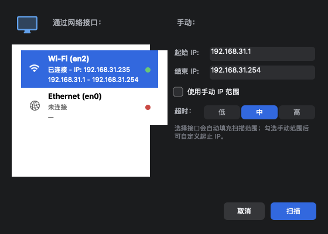
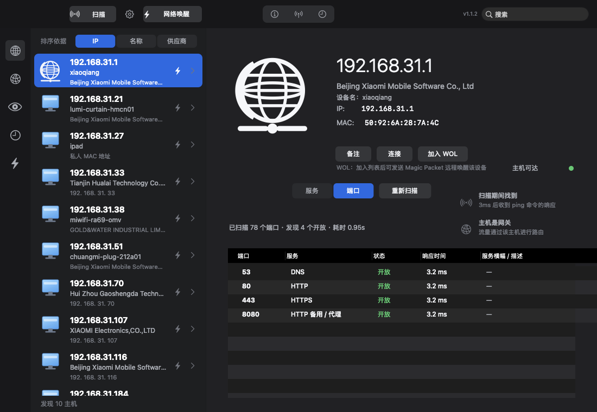
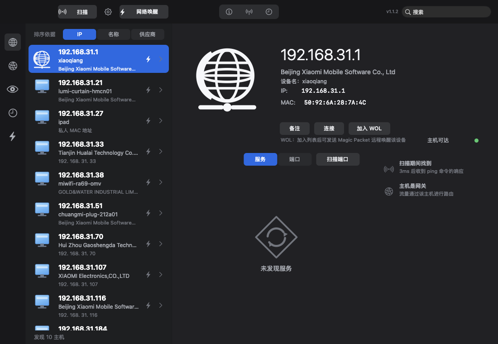
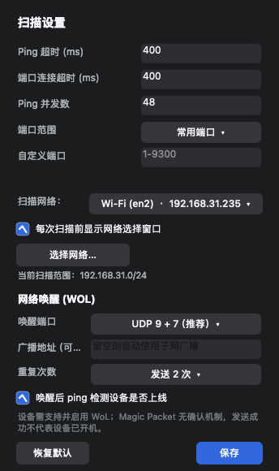
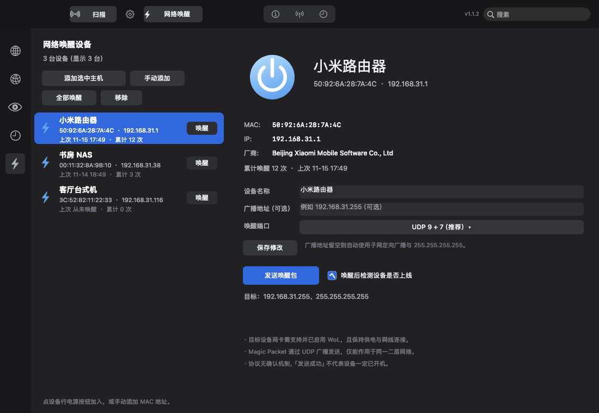

# LANScanner

一款 macOS 原生局域网扫描与管理工具。

## 功能特性

- **局域网设备扫描**: 自动发现 LAN 中的活跃设备，支持 ARP 缓存读取与主动 ping 扫描
- **设备信息展示**: 显示 IP 地址、MAC 地址、厂商信息、主机名等
- **端口扫描**: 对选中设备进行常见端口扫描，支持自定义端口列表
- **Wake on LAN (WOL)**: 支持远程唤醒设备，可批量唤醒
- **网络选择**: 支持多网卡切换，可手动指定扫描 IP 范围
- **macOS 原生**: 使用 AppKit 开发，界面简洁美观

## 系统要求

- macOS 11.0 (Big Sur) 或更高版本
- 需要管理员权限以读取 ARP 表和执行网络操作

## 安装

### 方法一：下载预编译版本

从 [Gitee Releases](https://gitee.com/xiaoyf/lanscanner/releases) 下载最新版本的 `.dmg` 安装包，双击打开后将应用拖入「应用程序」文件夹。

### 方法二：源码编译

```bash
# 克隆仓库
git clone https://gitee.com/xiaoyf/lanscanner.git
cd lanscanner

# 编译项目
./build.sh

# 编译完成后，应用将位于 build/ 目录下
```

## 使用方法

1. **启动应用**: 在「应用程序」文件夹中打开 LANScanner
2. **选择网络**: 首次使用会弹出网络选择器，选择您要扫描的网卡和 IP 范围
3. **开始扫描**: 点击工具栏的「扫描」按钮开始扫描局域网设备
4. **查看详情**: 点击列表中的设备查看详细信息，包括端口扫描结果
5. **WOL 唤醒**: 选中设备后点击「WOL」按钮可将设备添加到唤醒列表，支持远程唤醒

### 快捷键

- `Cmd + R`: 重新扫描
- `Cmd + ,`: 打开设置
- `Cmd + F`: 搜索设备

## 配置选项

在「设置」中可以配置以下选项：

- **Ping 超时**: 单次 ping 超时时间（毫秒）
- **端口超时**: 端口扫描超时时间
- **并发数**: 同时扫描的设备数量
- **端口预设**: 选择常用端口组合或自定义端口
- **WOL 设置**: 广播地址、端口模式、重复次数等

## 技术实现

- **UI 框架**: AppKit (NSViewController, NSTableView)
- **网络检测**: 使用 `ifconfig`、`netstat`、`arp` 等系统命令
- **ARP 读取**: 直接读取内核路由缓冲区获取 ARP 表
- **端口扫描**: 基于 socket 的 TCP 连接检测
- **WOL 实现**: 构造 Magic Packet 通过 UDP 广播发送

## 许可证

MIT License

## 贡献

欢迎提交 Issue 和 Pull Request！

## 界面预览





